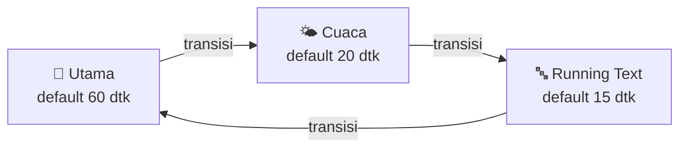

# 🚀 dejede-oled-monitor-I2C

[](https://wa.me/6285236578999)


> Utilitas monitoring koneksi internet seluler *real-time* dengan animasi visual dinamis untuk router **OpenWrt** Anda, menggunakan layar **LCD OLED 0.96" I2C (128x64)** dan integrasi modem **Dell DW5821e (ModemManager)**.

**Dejede OLEDMON** kini dilengkapi halaman pengaturan **LuCI**: ganti running text, lokasi cuaca, tema, tata letak, transisi, dan durasi tiap scene langsung dari browser, tanpa edit file dan tanpa restart.

---

## ✨ Fitur

| | Fitur | Keterangan |
|---|---|---|
| 📶 | **Monitor modem** | Kekuatan sinyal (bar + persen), operator, band LTE/CA, suhu chip modem |
| 📈 | **Grafik jaringan** | Line chart **Upload** dan **Download** terpisah, atau tampilan klasik angka UP/DWN |
| 🌤️ | **Cuaca** | Ikon animasi sederhana, suhu, kelembapan, angin, dan suhu terasa (Open-Meteo, tanpa API key) |
| 🔤 | **Running text** | Teks berjalan di scene utama dan scene layar penuh bergaya cyberpunk (equalizer, glitch, progress bar) |
| 🎞️ | **Transisi antar scene** | Geser (4 arah), wipe, buka dari tengah, kerai, dissolve, atau acak |
| 🎨 | **Tema & tata letak** | Normal / terbalik, kecerahan, putar 180°, beberapa layout per scene |
| 🖥️ | **Kontrol LuCI** | Semua pengaturan lewat *Services → Dejede OLEDMON*, berlaku otomatis dalam ±2 detik |
| 🛡️ | **Ringan & tahan banting** | Single instance, retry saat bus I2C belum siap, backoff saat modem error, auto-respawn |

### 🔁 Alur scene



Scene yang dinonaktifkan dilewati. Scene cuaca otomatis dilewati selama data cuaca belum tersedia.

---

## 🧰 Kebutuhan

**Perangkat keras**
- Router OpenWrt dengan bus I2C yang bisa diakses (hardware atau `i2c-gpio`)
- OLED **SSD1306 0.96" 128x64** I2C (alamat umum `0x3C`)
- Modem seluler berbasis ModemManager (diuji dengan **Dell DW5821e**)

**Perangkat lunak**
- OpenWrt 23.x atau lebih baru dengan LuCI
- `python3`, `python3-pillow`, dan library **luma.oled**
- Driver I2C kernel dan `i2c-tools` (untuk pengecekan)
- `modeminfo` (perintah yang dipakai skrip untuk membaca data modem)
- Akses internet dari router (untuk data cuaca)

> Nama paket dan driver I2C bergantung pada target/perangkat Anda. Contoh di bawah adalah titik awal, sesuaikan dengan firmware Anda.

---

## 📦 Instalasi

### 1) Siapkan dependensi

OpenWrt 23.05 / 24.10 (`opkg`):

```sh
opkg update
opkg install python3 python3-pip python3-pillow i2c-tools kmod-i2c-core kmod-i2c-algo-bit
```

OpenWrt 25.x (`apk`):

```sh
apk update
apk add python3 python3-pip python3-pillow i2c-tools kmod-i2c-core kmod-i2c-algo-bit
```

Pasang library OLED (tidak tersedia di feed resmi):

```sh
pip3 install luma.oled
```

Cek bahwa OLED terdeteksi (ganti `2` sesuai nomor bus I2C Anda):

```sh
i2cdetect -y 2     # alamat 3c harus muncul
```

### 2) Pasang Dejede OLEDMON

**Cara A: skrip instal (paling mudah, tanpa SDK)**

```sh
git clone https://github.com/<username>/dejede-oled-monitor.git
scp -r dejede-oled-monitor root@192.168.1.1:/tmp/
ssh root@192.168.1.1 "sh /tmp/dejede-oled-monitor/install.sh"
```

Skrip akan:
1. memasang `oled_monitor.py` ke `/usr/bin/`
2. memasang halaman LuCI dan hak akses (ACL)
3. memasang init script bila belum ada
4. memasang konfigurasi default (konfigurasi lama dicadangkan ke `/etc/config/oled_monitor.bak`)
5. mengaktifkan dan menjalankan layanan

**Cara B: build sebagai paket `.ipk` / `.apk`**

Letakkan folder ini di feed LuCI pada buildroot (`feeds/luci/applications/luci-app-oled-monitor`), lalu:

```sh
make package/luci-app-oled-monitor/compile
```

**Cara C: manual**

```sh
cp root/usr/bin/oled_monitor.py /usr/bin/ && chmod +x /usr/bin/oled_monitor.py
cp root/etc/init.d/oled_monitor /etc/init.d/ && chmod +x /etc/init.d/oled_monitor
cp root/etc/config/oled_monitor /etc/config/
cp root/usr/share/luci/menu.d/*.json /usr/share/luci/menu.d/
cp root/usr/share/rpcd/acl.d/*.json /usr/share/rpcd/acl.d/
mkdir -p /www/luci-static/resources/view/oled_monitor
cp htdocs/luci-static/resources/view/oled_monitor/settings.js /www/luci-static/resources/view/oled_monitor/
rm -rf /tmp/luci-indexcache /tmp/luci-modulecache
/etc/init.d/rpcd restart
/etc/init.d/oled_monitor enable && /etc/init.d/oled_monitor start
```

### 3) Buka LuCI

**Services → Dejede OLEDMON**. Jika menu belum muncul, logout lalu login ulang atau refresh dengan `Ctrl+F5`.

---

## ⚙️ Pengaturan di LuCI

| Bagian | Yang bisa diatur |
|---|---|
| **Status layanan** | Start / Stop / Restart, log terakhir |
| **Tema & Transisi** | Tema normal/terbalik, kecerahan 0–255, putar 180°, efek dan lama transisi (0–2000 ms) |
| **Scene Utama** | Aktif/nonaktif, durasi, layout (klasik / grafik), isi dan kecepatan running text |
| **Scene Cuaca** | Aktif/nonaktif, durasi, layout (klasik / rinci), kota, lat/lon, tombol **Cari lokasi**, satuan °C/°F, interval update |
| **Scene Running Text** | Aktif/nonaktif, durasi, gaya (cyberpunk / polos), 3 bagian teks, kecepatan, efek glitch |

### ⏱️ Nilai default

| Scene | Durasi |
|---|---|
| Utama | **60 detik** (1 menit) |
| Cuaca | **20 detik** |
| Running text | **15 detik** |

Transisi default: **geser kiri, 600 ms**.

---

## 🛠️ Konfigurasi manual (UCI)

File: `/etc/config/oled_monitor`. Perubahan dibaca otomatis tanpa restart.

```uci
config global 'global'
	option theme 'normal'          # normal | inverted
	option contrast '255'          # 0-255
	option flip '0'                # 1 = putar 180 derajat
	option transition 'slide_left' # none | random | slide_left | slide_right | slide_up
	                               # | slide_down | wipe | open | blinds | dissolve
	option transition_ms '600'

config scene 'main'
	option enable '1'
	option duration '60'
	option layout 'classic'        # classic | graph
	option marquee '1'
	option text '>> DEJEDE : 085236578999 - PHOTO & VIDEO SERVICES <<'
	option speed '40'

config scene 'weather'
	option enable '1'
	option duration '20'
	option layout 'classic'        # classic | detail
	option city 'Jakarta'
	option lat ''                  # opsional, mengalahkan pencarian nama kota
	option lon ''
	option unit 'c'                # c | f
	option refresh '15'            # menit

config scene 'ticker'
	option enable '1'
	option duration '15'
	option style 'cyber'           # cyber | plain
	option text1 'DEJEDE'
	option text2 'PHOTO & VIDEO'
	option text3 '085236578999'
	option speed '50'
	option glitch '1'
```

Contoh lewat terminal:

```sh
uci set oled_monitor.main.text='Selamat datang di Dejede'
uci set oled_monitor.weather.city='Bogor'
uci commit oled_monitor
```

---

## 🧯 Pemecahan masalah

<details>
<summary><b>OLED tidak menyala / "OLED tidak terdeteksi"</b></summary>

- Jalankan `i2cdetect -y <bus>` dan pastikan alamat `3c` muncul.
- Sesuaikan `I2C_PORT` dan `I2C_ADDRESS` di bagian atas `/usr/bin/oled_monitor.py`.
- Periksa kabel SDA/SCL, VCC, dan GND, serta modul kernel I2C.
</details>

<details>
<summary><b>Data sinyal tampil "NO DATA" atau "NO MODEMINFO"</b></summary>

- Pastikan perintah `modeminfo` ada dan menghasilkan JSON: jalankan `modeminfo` di terminal.
- Pastikan ModemManager mengenali modem: `mmcli -L`.
</details>

<details>
<summary><b>Cuaca tidak muncul atau tidak sesuai</b></summary>

- Scene cuaca otomatis dilewati sampai data pertama berhasil diambil (sekitar 20 detik setelah layanan mulai).
- Pastikan router punya internet. Data cuaca berasal dari Open-Meteo, yaitu perkiraan model per kotak peta, bukan pengamatan stasiun.
- Lihat log: `tail /var/log/oled_monitor.log`. Setiap pengambilan cuaca mencatat koordinat dan nilai mentahnya.
- Jika `lat` dan `lon` diisi, koordinat itu yang dipakai; nama kota hanya menjadi judul.
</details>

<details>
<summary><b>Menu LuCI tidak muncul</b></summary>

```sh
rm -rf /tmp/luci-indexcache /tmp/luci-modulecache
/etc/init.d/rpcd restart
```

Lalu logout dan login kembali.
</details>

<details>
<summary><b>Transisi terlihat patah-patah</b></summary>

Bus I2C 100 kHz membatasi jumlah frame per detik. Naikkan kecepatan bus I2C ke 400 kHz bila perangkat Anda mendukung.
</details>

Perintah berguna:

```sh
/etc/init.d/oled_monitor restart      # restart layanan
logread -e oled                       # log sistem
tail -f /var/log/oled_monitor.log     # log aplikasi
```

---

## 🗂️ Struktur repo

```
dejede-oled-monitor/
├── Makefile                                  # paket luci-app-oled-monitor
├── install.sh                                # pemasang cepat
├── root/
│   ├── etc/config/oled_monitor               # konfigurasi default
│   ├── etc/init.d/oled_monitor               # init script (procd)
│   ├── usr/bin/oled_monitor.py               # program utama
│   └── usr/share/
│       ├── luci/menu.d/...json               # menu LuCI
│       └── rpcd/acl.d/...json                # hak akses LuCI
└── htdocs/luci-static/resources/view/oled_monitor/settings.js
```

---

## 🗑️ Uninstall

```sh
/etc/init.d/oled_monitor stop && /etc/init.d/oled_monitor disable
rm -f /usr/bin/oled_monitor.py /etc/init.d/oled_monitor /etc/config/oled_monitor
rm -f /usr/share/luci/menu.d/luci-app-oled-monitor.json /usr/share/rpcd/acl.d/luci-app-oled-monitor.json
rm -rf /www/luci-static/resources/view/oled_monitor
/etc/init.d/rpcd restart
```

---

## 🙌 Kontribusi & dukungan

Saran, laporan bug, dan pull request sangat diterima. Untuk pertanyaan atau layanan lain, hubungi:

[](https://wa.me/6285236578999)

**DEJEDE** · Photo & Video Services

## 📄 Lisensi

Dirilis di bawah lisensi [MIT](LICENSE). Data cuaca oleh [Open-Meteo](https://open-meteo.com/).
